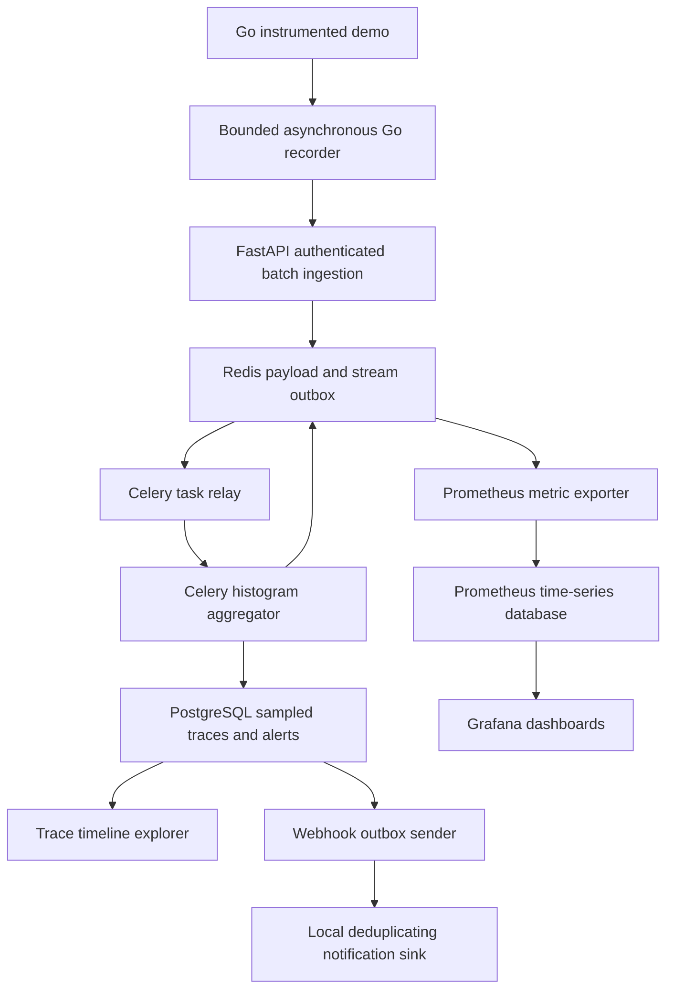

# Real-Time Observability & Distributed Telemetry Pipeline

Go asynchronous instrumentation/agent, FastAPI ingestion, Redis durable admission outbox, Python Celery aggregation, Prometheus time-series storage, PostgreSQL metadata/sampled traces/alerts, Grafana dashboards, and a lightweight trace timeline explorer.

Includes source, Docker Compose, example dashboards, tests, raw benchmarks, failure evidence, and resume bullets. Measurements are actual local results; the proposed 50,000 packets/s, <2% system memory, and 40% lookup improvement are not assumed.

## Architecture



High-volume metrics are aggregated into bounded histograms/counters; SQL handles metadata, sampled trace spans and alert records. Prometheus persists scraped time series. Each user request in the Go demo produces one checkout root span and inventory/payment children sharing a trace ID.

## Run locally with Docker

Requirements: Docker Engine/Desktop with Compose v2. The stack is a private development demo.

```bash
unzip telemetry-pipeline.zip
cd telemetry-pipeline
# Use 100% sampling for the first small trace demo:
TRACE_SAMPLE_RATE=1 docker compose up -d --build --scale worker=2
curl http://localhost:8083/demo
```

PowerShell users can set `$env:TRACE_SAMPLE_RATE='1'` before `docker compose up -d --build --scale worker=2`.

The agent returns a trace ID. Wait for the next flush/processing, then query:

```bash
curl http://localhost:8082/traces/TRACE_ID -H 'Authorization: Bearer demo-token'
curl http://localhost:8083/stats
curl http://localhost:8082/services/checkout/window -H 'Authorization: Bearer demo-token'
```

| Surface | URL / credentials |
| --- | --- |
| API and Swagger | `http://localhost:8082/docs` |
| Trace timeline | `http://localhost:8082/ui` — paste `demo-token` and the trace ID |
| Go demo / recorder stats | `http://localhost:8083/demo`, `/stats` |
| Prometheus query UI | `http://localhost:9090` |
| Grafana | `http://localhost:3000`; `admin` / `demo-grafana-password` |

Grafana's provisioned **Distributed Telemetry Pipeline** dashboard shows processed span rate, estimated p99, complete-minute p99 upper bound, error rate, agent memory and CPU. First rate plots need multiple scrapes. Complete-window gauges exclude the current partial 10-second bucket; empty windows have no p99 value.

Normal trace sampling is 1%. For measured-load reproduction, restart workers with that setting:

```bash
TRACE_SAMPLE_RATE=0.01 docker compose up -d --force-recreate --scale worker=2 worker
```

## API and payload

All telemetry/config-read APIs require `Authorization: Bearer demo-token`; the metrics exporter and health checks are on the private network without bearer authentication.

| Endpoint | Behavior |
| --- | --- |
| `POST /ingest` | 202 persistent batch receipt, not aggregation completion; 409 conflicting batch reuse; 422 malformed or unknown service; 401 invalid token. |
| `GET /batches/{id}` | QUEUED or DONE; 24-hour batch status/dedup retention. |
| `GET /traces/{trace_id}` | Sampled spans in start-time order, with parent relationships; 404 if absent/unsampled. |
| `GET /services/{name}/window` | Complete-minute count, mean and histogram p99 upper bound. |
| `GET /alerts` | Latest 100 alert episodes owned by the demo user. |
| `GET /metrics` | Prometheus exposition endpoint. |
| `GET /health/live`, `/health/ready` | Process and dependency readiness. |

Example raw batch:

```json
{
  "batch_id": "11111111111111111111111111111111",
  "spans": [{"trace_id":"00000001000000000000000000000000", "span_id":"0000000000000001", "service":"checkout", "operation":"POST /checkout", "start_ms":1791540000000, "duration_ms":235, "status":500}],
  "runtime": {"heap_bytes":1048576, "peak_rss_bytes":8388608, "cpu_cores":0.1}
}
```

Send the same batch ID/body to retry without double counting. `parent_id` is optional for roots; children use their parent's span ID. Maximum batch size is 1,000; the Go agent flushes at 500 spans or 500 ms. Times are epoch milliseconds for trace display; duration is ms. Runtime metrics are process values. Registered demo services: `checkout`, `inventory`, `payments`.

## Alert configuration and notification demo

Alert rules are trusted operator-managed relational configuration. Create a five-minute rule:

```bash
docker compose exec postgres psql -U telemetry -d telemetry -c "INSERT INTO alert_rules(service,threshold_ms,for_seconds,min_samples) VALUES('checkout',200,300,100);"
```

Celery beat evaluates every 10 seconds and dispatches webhook outbox work every two seconds. Rule breaches must persist across fresh, populated windows for the configured duration. The metric is a **p99 bucket upper bound**, so alerts can be conservative at bucket boundaries. Missing data resolves the episode; missed evaluator ticks reset pending continuity. For a brief local demo, set `for_seconds=0` and a low threshold, then generate Go demo requests continuously for several seconds.

The bundled webhook sink receives synthetic local notifications only. Inspect:

```bash
docker compose exec postgres psql -U telemetry -d telemetry -c 'SELECT * FROM webhook_receipts;'
curl http://localhost:8082/alerts -H 'Authorization: Bearer demo-token'
```

No real Slack/email notifications are sent. Sending to external channels requires an adapter and receiver idempotency handling; it is not a completed Slack/email integration.

## Tests and reproducible benchmarks

```bash
python -m venv .venv
# Linux/macOS; Windows: .venv\Scripts\activate
. .venv/bin/activate
pip install -r requirements.txt
python -m pytest -q
cd agent
go test -race ./...
go test -run '^$' -bench BenchmarkRecord -benchmem ./internal/telemetry
cd ..
```

Python unit-only execution skips real database/Redis checks. Integration tests should run against an idle dedicated demo database/cache, with worker/relay/beat stopped; alert tests disable fixture rules and manipulate controlled evaluation times.

```bash
docker compose stop worker relay beat
docker compose --profile tests run --rm tests
docker compose up -d --scale worker=2 worker relay beat
```

Load benchmark through the actual HTTP API, with workers/relay/Prometheus running:

```bash
python -m scripts.benchmark --output results/reproduction
```

Three runs, each 100 batches × 500 span events at 16 concurrent clients. Reports batch request rate, admitted span rate, **completed span rate including drain**, p50/p95/p99 batch admission latency, response counts and all batch IDs. Keep the worker trace sample rate at 1% to match delivery evidence. HTTP batches and span events are different units; 500 span events in one request are not 500 network packets.

Native development: set `DATABASE_URL`, `REDIS_URL`, `CELERY_BROKER_URL`, `API_TOKEN`, run `python -m app.cli migrate`, then separate processes:

```bash
python -m uvicorn app.api:app --port 8082
python -m app.relay
python -m celery -A app.tasks worker --pool solo --loglevel info
python -m celery -A app.tasks beat --schedule /tmp/telemetrybeat
python -m uvicorn app.webhook:app --port 8090
# Another terminal:
cd agent && go run ./cmd/agent
```

See [DESIGN.md](docs/DESIGN.md) for retry, sampling, window, cache, auth, retention and failure semantics. These are development patterns; no HA deployment is claimed.

Metadata-cache comparison from inside the demo network:

```bash
docker compose run --rm --no-deps api python -m scripts.lookup > results/lookup-reproduction.json
```

Worker-exit recovery (use an idle demo stack, with no other queued batches):

```bash
python -m scripts.recovery
```

The broker's restoration polling cadence can make actual recovery much longer than its five-second test visibility setting; the script waits for actual completion. Default operation uses 60 seconds. The script preserves data and restores normal workers/beat afterward.

## Measured outcomes and resume bullets

Measured on **2026-10-09 UTC** against real native PostgreSQL, Redis, Celery workers, FastAPI HTTP, Go agent and Prometheus. Grafana provisioning and the browser UI are supplied but were not browser-rendered here. Docker was unavailable; image builds/container execution were not performed.

**150,000 span events completed across three 50,000-span bursts. Median batch-load-plus-drain throughput: 23,377.86 completed spans/s (~23.4k)**. All 300 HTTP batches were accepted and reached DONE.

| Run | Accepted HTTP batches/s | Admitted spans/s | Completed spans/s, including drain | Batch admission p95 / p99 (ms) |
| --- | ---: | ---: | ---: | ---: |
| 1 | 100.74 | 50371.36 | 24514.18 | 210.497 / 226.242 |
| 2 | 97.35 | 48673.45 | 23377.86 | 222.916 / 252.075 |
| 3 | 89.64 | 44817.62 | 22970.41 | 231.289 / 237.020 |

**Agent measurements:** 3,000 Go demo requests attempted 9,000 spans; **all 9,000 were accepted by ingestion, zero reported drops and zero send failures**. Agent-reported peak RSS was **63.82 MiB**, heap allocation in the final sample **3.37 MiB**. The peak was **0.779% of this sandbox’s 8 GiB memory limit**, not a universal percentage of system RAM. The last CPU snapshot was about 0.049 CPU cores; it is not whole-run CPU utilization. The separate Go recorder microbenchmark measured **32.19 ns/op, 0 B/op, 0 allocations/op**, including periodic queue draining but excluding ID creation, span construction, serialization and network delivery.

**Metadata lookup:** 3,000 uncached SQL queries vs 3,000 warm Redis cache reads, using the same reused PostgreSQL connection. p50 was **0.036465 ms → 0.034202 ms**, a **6.21%** reduction. This small local difference is noise-sensitive; it does not establish 40% improvement or an index speedup. The query plan is included, and a tiny table can appropriately use a sequential scan.

**Reliability and correctness evidence:**

- **8 Python tests** passed across the main integration run and the separate local-webhook replay test; **3 Go tests** passed with the race detector, including a failed-send retry reusing its batch ID.
- Exact synthetic 300-second alert-duration behavior was checked with controlled evaluation timestamps. The live end-to-end notification test used FOR 0, sent HTTP only to the bundled local receiver, and persisted one receipt for the tested alert.
- Actual Celery worker exit code 42 before aggregation; all admitted batches subsequently reached DONE. **Observed full recovery was 91.423 seconds** with a five-second broker visibility setting. Polling restoration cadence, not just visibility timeout, determines actual recovery latency.
- Redelivering a completed task did not increment aggregate metrics; repeated sampled-span inserts and local webhook receipts deduplicated with relational uniqueness.
- A three-service parent/child trace was persisted and queried through the HTTP API.
- Actual Prometheus scraping/querying returned `telemetry_processed_spans_total = 159025`, including test fixtures, load bursts and Go demo spans. The six complete-window buckets and p99 upper-bound calculations passed boundary tests.

**Resume bullets:**

- **Built a multi-tier telemetry pipeline with Go, Celery, Redis, Prometheus and PostgreSQL; completed 150,000 span events at ~23.4k spans/s median throughput including queue drain across three local burst tests.**
- **Implemented bounded asynchronous Go instrumentation, aligned one-minute latency histograms, sampled parent/child trace storage and Grafana dashboards; measured ~64 MiB agent peak RSS with zero reported drops across a 9,000-span local demo test.**
- **Added idempotent batch processing and transactional alert/webhook outboxes; verified recovery after an actual Celery worker exit, duplicate-safe metrics, sampled traces and local notification receipts.**

Suggested title: **Distributed Telemetry & Observability Pipeline | Go, Python/Celery, Redis, Prometheus, PostgreSQL, Grafana**.

These are short single-host, batched synthetic tests with 1% trace sampling, not sustained multi-host capacity. One run admitted ~50k span events/s, but HTTP packet rate was ~101 batches/s and completed throughput was ~24.5k spans/s. Do not claim 50,000 network packets/s, 40% lookup improvement, globally lossless telemetry, zero application overhead, universal <2% RAM, log rotation, complete user login management, production HA, or finished Slack/email integration.

Raw evidence is in `results/`: per-run measurements and batch IDs, agent memory/stats, Go microbenchmark, metadata timings/query plan, native recovery, sampled trace, local alert receipt, Prometheus query/exposition and test outputs. Environment and boundaries are documented in `results/ENVIRONMENT.md` and `docs/DESIGN.md`.

## Files

```text
agent/                      Go recorder, demo daemon, race tests and microbenchmark
app/api.py, models.py        Authenticated ingestion, trace/status APIs, exporter
app/aggregation.py          Atomic admission/aggregation and aligned sliding windows
app/relay.py, tasks.py       Redis outbox-to-Celery relay, aggregation and schedules
app/schema.sql, store.py     Relational metadata, sampling, cache and alert schemas
app/alerts.py, webhook.py    Persistent alert episodes/outbox and local sink
app/ui.html                 Service-span timeline explorer
scripts/benchmark.py        Reproducible HTTP batch + drain benchmark
deploy/                     Prometheus and Grafana provisioning
results/                    Actual benchmark/test evidence and environment
docs/DESIGN.md              Explicit semantics and limitations
```

## Primary references

- [Prometheus histograms and quantiles](https://prometheus.io/docs/practices/histograms/)
- [Celery ACK, retry and prefetch configuration](https://docs.celeryq.dev/en/v5.5.3/userguide/configuration.html)
- [Grafana provisioning](https://grafana.com/docs/grafana/latest/administration/provisioning/)
